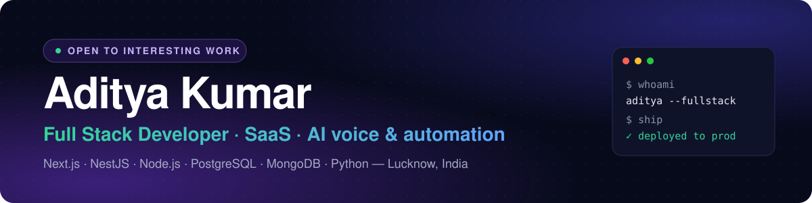

  

  
  
  
  

## 👋 About me

I'm **Aditya Kumar**, a **Full Stack Developer in Lucknow, India**. I build production SaaS platforms, **AI voice-calling systems**, **WhatsApp automation** and **n8n workflows** with **Next.js, NestJS, Node.js, PostgreSQL and MongoDB**.

- 💼 **Full Stack Developer at [Feeding Trends](https://eraditya.vercel.app/experience)** (Feb 2026 – present): AI calling (Callio AI), influencer-marketing SaaS (Amplibuzz) and internal security tooling (Observiq)
- 🤖 Building **AI agents and MCP servers**. My [portfolio has its own AI agent](https://eraditya.vercel.app) and an [MCP server](https://eraditya.vercel.app/mcp) you can add to Claude, ChatGPT or Cursor
- 🧠 Currently going deeper into **system design, BullMQ job queues and backend performance**
- 🎓 Diploma in CSE (BTEUP), now pursuing **B.Tech in Computer Science (AKTU)**
- 📫 Open to freelance and full-time roles: **[get in touch](https://eraditya.vercel.app/contact)**

## 🚀 Featured work

<table>
  <tr>
    <td width="50%" valign="top">
      
      <h3><a href="https://eraditya.vercel.app/projects/cheetah-agi">Cheetah AGI</a></h3>
      Multi-model LLM router and agent workflow engine that picks the cheapest, fastest provider for each task. 
      <b>Node.js · NestJS · Next.js · TypeScript · OpenAI · Claude · Gemini</b> 
      <a href="https://cheetahagi.com/">Live</a> · <a href="https://eraditya.vercel.app/projects/cheetah-agi">Case study</a>
    </td>
    <td width="50%" valign="top">
      
      <h3><a href="https://eraditya.vercel.app/projects/callio-ai-ai-calling-voice-ai-platform">Callio AI</a></h3>
      Outbound AI calling platform: cloud telephony + ElevenLabs voices with sub-300 ms real-time responses. 
      <b>Next.js · NestJS · PostgreSQL · Redis · BullMQ · Socket.io · ElevenLabs</b> 
      <a href="https://callio.cheetahagi.com/">Live</a> · <a href="https://eraditya.vercel.app/blog/callio-ai">Write-up</a>
    </td>
  </tr>
  <tr>
    <td width="50%" valign="top">
      
      <h3><a href="https://eraditya.vercel.app/projects/amplibuzz">Amplibuzz</a></h3>
      Influencer-marketing platform with escrow wallets and automated post verification. 
      <b>Next.js · NestJS · PostgreSQL · Prisma · Redis · BullMQ · Puppeteer</b> 
      <a href="https://amplibuzz.com/">Live</a> · <a href="https://eraditya.vercel.app/blog/amplibuzz">Write-up</a>
    </td>
    <td width="50%" valign="top">
      
      <h3><a href="https://eraditya.vercel.app/projects/wautomator-enterprise-whatsapp-marketing-automation-platform">WAutomator</a></h3>
      Multi-tenant WhatsApp marketing SaaS on Meta's Cloud API: campaigns, AI chatbots and live analytics. 
      <b>Next.js · NestJS · PostgreSQL · Prisma · Redis · BullMQ · TanStack Query</b> 
      <a href="https://whatsapp.billionairevox.com/">Live</a> · <a href="https://eraditya.vercel.app/projects/wautomator-enterprise-whatsapp-marketing-automation-platform">Case study</a>
    </td>
  </tr>
  <tr>
    <td width="50%" valign="top">
      
      <h3><a href="https://eraditya.vercel.app/projects/brightveil">BrightVeil LMS</a></h3>
      Learning platform with video courses, live classes, progress analytics and Razorpay payments. 
      <b>Next.js · Node.js · Express · MongoDB · Cloudinary · Razorpay</b> 
      <a href="https://brightveil.vercel.app/">Live</a> · <a href="https://github.com/ErAditya1/BrightVeil-Next">Code</a>
    </td>
    <td width="50%" valign="top">
      
      <h3><a href="https://eraditya.vercel.app/projects/super-tasky-advanced-task-productivity-management-system">Super Tasky</a></h3>
      Real-time task and productivity manager for individuals and teams. 
      <b>Next.js · Node.js · Express · MongoDB · Redux · shadcn/ui</b> 
      <a href="https://supertasky.vercel.app/">Live</a> · <a href="https://eraditya.vercel.app/projects/super-tasky-advanced-task-productivity-management-system">Case study</a>
    </td>
  </tr>
</table>

<a href="https://eraditya.vercel.app/projects"><b>See all projects →</b></a>

## 🛠️ Tech stack

   
  

Also: BullMQ · Socket.io · Playwright · n8n · ElevenLabs · Deepgram · Razorpay · Cloudinary · MCP · AG-UI

## 📊 Live GitHub activity

  <a href="https://eraditya.vercel.app/#github">
    <picture>
      <source media="(prefers-color-scheme: dark)" srcset="https://eraditya.vercel.app/api/github/card?theme=dark" />
      <source media="(prefers-color-scheme: light)" srcset="https://eraditya.vercel.app/api/github/card?theme=light" />
      
    </picture>
  </a>

Served live from my portfolio's GitHub API integration and refreshed every few minutes. Most client work is in private repos, so it shows up as contributions.

<picture>
  <source media="(prefers-color-scheme: dark)" srcset="https://raw.githubusercontent.com/ErAditya1/Eraditya1/output/github-snake-dark.svg" />
  <source media="(prefers-color-scheme: light)" srcset="https://raw.githubusercontent.com/ErAditya1/Eraditya1/output/github-snake.svg" />
  
</picture>

## ✍️ Latest from my blog

<!-- BLOG-POST-LIST:START -->
- [8 n8n Workflows I Built to Automate a Shopify Store &lpar;Abandoned Carts, Email Tracking &amp; Analytics&rpar;](https://eraditya.vercel.app/blog/n8n-shopify-automation-workflows)
- [I Turned My Portfolio Into an AI Agent with AG-UI and MCP](https://eraditya.vercel.app/blog/portfolio-ai-agent-ag-ui-mcp)
- [How I Built a Scalable LMS with Next.js &amp; Node.js](https://eraditya.vercel.app/blog/how-i-built-a-scalable-lms-with-nextjs)
- [Observiq: Building a Social Intelligence and Plagiarism-Detection Platform](https://eraditya.vercel.app/blog/observiq-trubetix)
- [Amplibuzz: Fixing Trust in Influencer Marketing with Escrow and Post Checks](https://eraditya.vercel.app/blog/amplibuzz)
<!-- BLOG-POST-LIST:END -->

  

